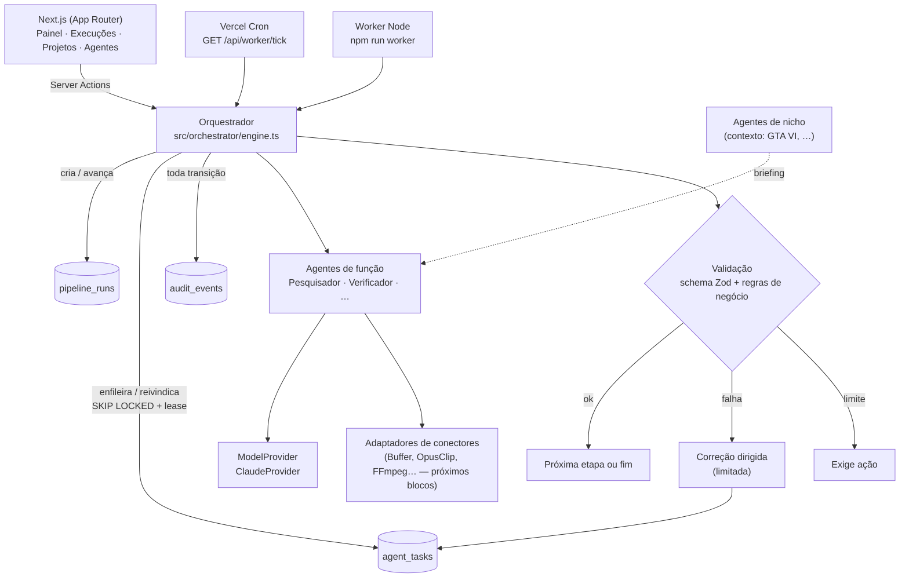

# Plataforma Multiagente de Conteúdo — Arquitetura (Bloco A)

Base: "Especificação Plataforma Multiagente de Conteúdo Viral GTA VI" v1.0, seção 12.
Este documento cobre as 7 entregas pedidas antes do código. O Bloco B (fundação) está implementado neste repositório.

## 1. Diagnóstico

| Item | Situação encontrada | Decisão |
|---|---|---|
| Repositório `gta-daily` | Só artefatos de um plano anterior descartado (scripts Python, radar, pautas). Nada reaproveitável para orquestração com estado. | Conteúdo antigo removido em commit normal; o histórico fica no git. |
| Instagram GTA DAILY | Conta existente; é o primeiro canal-alvo. | Plataformas do projeto: Reels e Carrossel/Foto (TikTok e Shorts opcionais). |
| Supabase | Projeto novo `gta-daily-plataforma` (ref `lcocstithbpjtsupgsiv`, sa-east-1, plano free) na organização "Agatha". | Migration do Bloco B aplicada; advisor de segurança sem alertas. |
| Vercel | Conector disponível na sessão, sem time listado e sem deploy. | Deploy fica para quando os segredos estiverem configurados. |
| Claude API | Sem `ANTHROPIC_API_KEY` no ambiente. | Adaptador implementado; sem chave, as etapas param em "Exige ação" (não há execução simulada). |
| Demais conectores | vidIQ e Canva existem como ferramentas do assistente, não como APIs da plataforma. | Registrados como "precisa validar". |

**Riscos principais**
- Direitos de mídia: um vídeo público não autoriza download ou republicação (bloqueia o D/E sem fonte autorizada).
- Limite de execução serverless: tarefas longas (render, transcrição) exigem worker fora da função da Vercel.
- Alucinação de fontes: mitigada no Bloco B com validação que rejeita URL não recuperada pela busca.
- Custo de modelo: mitigado com reaproveitamento por hash de entrada + versão e limites de tentativas e correções.

## 2. Arquitetura

**Princípios**
- Duas camadas de agentes:
  - **Nicho** só fornece contexto (`src/core/niches.ts`).
  - **Função** é reutilizável entre nichos (`src/agents/`).
  - Um novo nicho não duplica o núcleo.
- Agentes não conhecem fornecedores. Falam com `ModelProvider` (`src/connectors/types.ts`), e cada fornecedor é um adaptador.
- Execução sob demanda: nada fica rodando permanentemente. A fila é consumida por worker ou cron.
- Estado sempre no banco: sair da tela não perde nada, e a UI só lê o estado salvo.
- Nenhum conector simulado. Sem credencial, o estado é `pending_credential` e a etapa vira "Exige ação" com a instrução de correção.

## 3. Contratos entre agentes

Envelope padrão (`src/core/contracts/common.ts`, `agentOutputEnvelope`). É montado **pelo orquestrador**, nunca pelo modelo:

| Campo | Origem |
|---|---|
| `task_id`, `project_id`, `run_id`, `agent_role`, `agent_version` | orquestrador |
| `status` (`completed`) | orquestrador |
| `result` | agente, validado pelo schema do papel |
| `evidence`, `limitations`, `unconfirmed` | regras de negócio do agente |
| `validation { passed, warnings }` | orquestrador |
| `next_step` | definição do pipeline (`fim` na última etapa) |

Schemas por papel (`src/core/contracts/research.ts`):

**Pesquisador `pesquisador@1.0.0`**
- Entrada: `topic`, `goal`, `niche_id`, `correction_notes`.
- Resultado: `summary`, `sources[]` (url, título, publisher, data), `claims_to_verify[]` (alegação + URLs + rótulo inicial), `unknowns[]`.
- Regra: toda fonte precisa ter sido de fato recuperada pela busca, senão é "possível URL inventada" e a saída é rejeitada.

**Verificador `verificador@1.0.0`**
- Entrada: pacote do Pesquisador.
- Resultado: cada alegação com rótulo, `confidence`, `evidence_urls` e notas, além de `contradictions`, `caveats` e `overall`.
- Rótulos possíveis: `fato_confirmado`, `rumor`, `teoria`, `estimativa`, `hipotese` ou `nao_verificado`.
- Regra: `fato_confirmado` exige evidência, e toda URL de evidência precisa ser conhecida.

Os demais 7 papéis estão declarados em `AGENT_ROLES` e aparecem na UI como "previstos". Cada um ganha schema próprio no seu bloco.

## 4. Modelo de dados

Migration: `supabase/migrations/20261023000001_fundacao_pipeline.sql`.

| Tabela | Finalidade | Campos-chave |
|---|---|---|
| `content_projects` | Projeto/nicho do usuário | `owner_id`, `niche`, `audience`, `language`, `platforms[]`, `editorial_rules`, `settings` (limites) |
| `pipeline_runs` | Uma execução de pipeline | `pipeline`, `input`, `status`, `current_step`, `idempotency_key` (único por projeto) |
| `agent_tasks` | Fila e histórico de etapas | `agent_role`, `agent_version`, `input`, `input_hash`, `output`, `status`, `attempts/max_attempts`, `corrections/max_corrections`, `validation`, `error`, `not_before`, `lease_owner/lease_expires_at`, `usage`, `duration_ms`, `reused_from`, `idempotency_key` (único) |
| `audit_events` | Trilha de auditoria | `actor`, `action`, `data`, vínculos com projeto, execução e tarefa |

**Segurança**
- RLS ligado em todas as tabelas.
- O usuário autenticado só **lê** o que é seu. Projetos podem ser criados e editados pelo dono.
- Execuções, tarefas e auditoria só são escritas pelo servidor/worker. Os grants de insert/update/delete foram revogados de `anon` e `authenticated`, então o cliente não consegue forjar estado.

**Cadeia completa (seção 8)**
- Projeto → fonte → análise → oportunidade → briefing → roteiro → corte → versão → revisão → publicação → métricas.
- `source_media`, `media_analysis`, `opportunities`, `clip_candidates`, `clip_versions`, `publication_drafts`, `publication_jobs` e `content_metrics` entram nos blocos C–H.

## 5. Orquestrador

`src/orchestrator/engine.ts`, classe `Orchestrator`.

**Estados de tarefa**
- `queued`, `running`, `waiting_input`, `succeeded`
- `failed_retryable`, `failed_action_required`, `cancelled`

**Estados de execução**
- `queued`, `running`, `waiting_input`, `succeeded`, `failed_action_required`, `cancelled`

**Fila**
- Reivindica com `UPDATE … WHERE id = (SELECT … FOR UPDATE SKIP LOCKED LIMIT 1)`, o que permite vários workers sem disputa.
- Elegíveis: `queued`/`failed_retryable` com `not_before <= now()`, ou `running` com lease expirado.
- Por isso, um worker que morreu tem a tarefa retomada automaticamente.

**Lease**
- Toda escrita de resultado exige `lease_owner = eu AND status = 'running'`.
- Um worker antigo que volta depois de perder o lease não sobrescreve nada: o evento é registrado como `task.lease_lost`.

**Idempotência**
- `pipeline_runs (project_id, idempotency_key)`: o formulário gera uma chave, então clique duplo não duplica a execução.
- `agent_tasks.idempotency_key = run_id:etapa`.

**Falhas**
- Erro recuperável do conector:
  - backoff exponencial `min(300 s, 5·2^(n-1))`;
  - até `max_attempts` (padrão 4, configurável por projeto).
- Erro não recuperável (sem credencial, autenticação, recusa): vai direto para `failed_action_required`, com ação sugerida na UI.
- Saída inválida (schema ou regra de negócio):
  - a etapa volta para a fila com `correction_notes` listando os problemas;
  - até `max_corrections` (padrão 2);
  - acima disso, vai para `failed_action_required`.

**Reaproveitamento**
- Uma etapa com o mesmo `agent_role` + `agent_version` + `input_hash` (ignorando notas de correção) e já concluída para o mesmo dono é reaproveitada sem custo de modelo.

**Retomar, cancelar e retentar**
- Cancelar marca a execução e as etapas pendentes. Uma etapa em andamento termina, mas não avança.
- "Tentar de novo" só vale para `failed_action_required`: zera tentativas e correções e reenfileira.

**Auditoria**
- Cada transição grava um `audit_events`, com versão, tentativa, erros, duração e uso de tokens quando houver.

**Execução da fila**
- `npm run worker`: processo contínuo, exige Postgres.
- `GET /api/worker/tick`: Vercel Cron, protegido por `CRON_SECRET`.
- Botão "Processar minha fila agora": processa só as tarefas do próprio usuário.

**Modelo**
- `claude-opus-5-5`, em duas chamadas:
  1. Pesquisa com `web_search`. As URLs são coletadas dos blocos de resultado da busca.
  2. Estruturação com *structured outputs* (schema Zod).
- Fallback do lado do servidor ativado (`server-side-fallback-2026-07-01`, `fallbacks: "default"`): em recusa por política, a API refaz a chamada no modelo de fallback padrão.

## 6. Matriz de conectores

Estado também visível em **Agentes e conectores** na UI (`src/connectors/registry.ts`).

| Conector | Classificação | Validado neste bloco | Falta |
|---|---|---|---|
| Supabase (Postgres, Auth, RLS) | **Confirmado** | Projeto criado, migration aplicada, advisor de segurança limpo | `DATABASE_URL` (senha do banco) nos segredos do app/worker |
| Claude API | **Precisa de credencial** | Adaptador e mapeamento de erros testados; sem chamada real | `ANTHROPIC_API_KEY` |
| Buffer API | **Precisa de credencial + validação documental** | — | Canais suportados, formatos, erros (Bloco G) |
| YouTube Data API | **Precisa de credencial** | — | Credencial Google Cloud; captions só de vídeos autorizados |
| vidIQ | **Precisa de validação documental** | — | Não há API pública confirmada para a plataforma; o acesso atual é só pelo assistente |
| OpusClip API | **Precisa de validação documental** | — | Disponibilidade da API, plano, custo, marca d'água |
| FFmpeg | **Precisa de validação** | — | Worker com FFmpeg instalado (não roda na função serverless) |
| Speech-to-text | **Precisa de validação** | — | Escolha de fornecedor (português, gameplay, custo) |
| Vercel | **Precisa de validação** | — | Projeto, segredos e cron |

## 7. Plano incremental e critérios de aceite

| Bloco | Escopo | Critério objetivo de aceite | Estado |
|---|---|---|---|
| A | Diagnóstico e arquitetura | Este documento; nada sobrescrito sem justificativa | ✅ |
| B | Fundação e orquestração | Tarefa criada, processada, validada, com falha recuperada e retomada, coberta por testes (`npm test`) | ✅ |
| C | Pesquisa/verificação real | Com `ANTHROPIC_API_KEY`: 3 temas GTA VI reais com 100% das fontes rastreáveis (URL recuperada) e incertezas explícitas; tabelas `opportunities` e `source_media`; portão de qualidade antes da estratégia | próximo |
| D | Central de Conteúdo | Vídeo de teste **autorizado** analisado (transcrição + segmentos); cortes com início, fim e justificativa | — |
| E | Produção e renderização | Arquivo 9:16 válido, legendas sincronizadas, reproduzível (mesma entrada → mesmo arquivo) | — |
| F | Adaptação por plataforma | Versões editáveis Reels, TikTok e Shorts (e carrossel) vinculadas ao corte e à fonte | — |
| G | Aprovação e Buffer | Aprovação humana obrigatória; publicação de teste real confirmada pelo provedor, ou pendência documentada | — |
| H | Analytics e aprendizado | Métricas com fonte e definição; recomendações ligadas às hipóteses | — |
| I | Expansão de nichos | Novo nicho (ex.: Tendências) configurado sem alterar `src/agents` nem o orquestrador | — |

### Testes do Bloco B (`tests/`)

O banco dos testes é PGlite, com as mesmas migrations e roles do Supabase.

- **Fluxo ponta a ponta:** Pesquisador → Verificador → execução concluída, com a sequência exata da auditoria.
- **Correção e validação:**
  - saída inválida → correção dirigida → sucesso;
  - limite de correções → "Exige ação";
  - `fato_confirmado` sem evidência é rejeitado;
  - URL inventada é rejeitada.
- **Falhas de conector:**
  - sem credencial → "Exige ação" → "Tentar de novo";
  - erro temporário → backoff.
- **Lease:**
  - worker "morre" → lease expira → outro worker retoma;
  - o worker antigo não sobrescreve.
- **Persistência:** o estado sobrevive à troca de instância do orquestrador.
- **Idempotência, reaproveitamento e cancelamento:** idempotência de execução, reaproveitamento por hash, cancelamento antes e durante a execução.
- **Isolamento:** entre usuários, no código e via RLS (`set role authenticated`). Inserts forjados e acesso `anon` são negados.
- **Contratos:** dados incompletos são rejeitados e o hash é estável.
